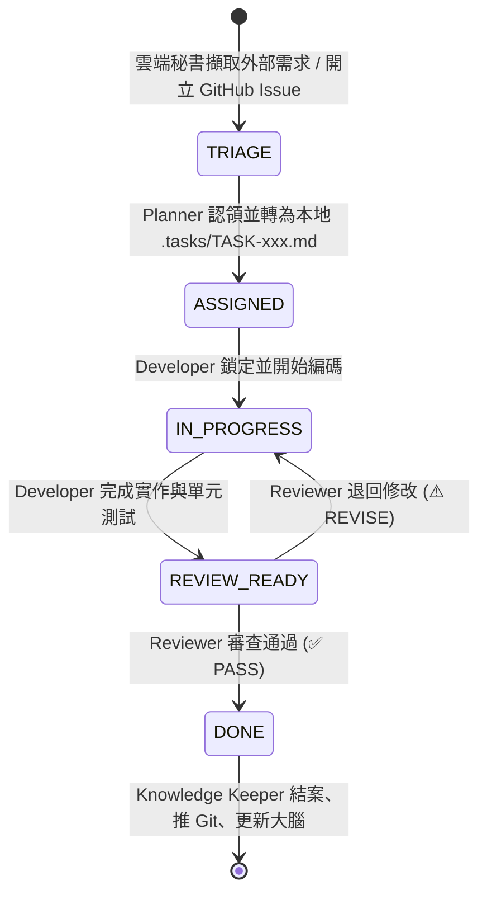

# 任務派發與多 Agent 通訊協議 (Task Dispatch Protocol)

> 版本：v1.0 (2026-09)  
> 適用範圍：2026AI_Employees 團隊成員跨平台協同標準（雲端 Gemini Spark ＋ 本機 AntiGravity）

---

## 1. 核心原則 (Guiding Principles)

1. **黑板模式 (Blackboard Pattern)**：成員之間不直接私訊閒聊，一律透過結構化「任務卡 (Task Card)」或「GitHub Issue」讀寫狀態。
2. **指針優先 (Pointer over Payload)**：禁止將大型程式碼或長篇文件整份貼入任務描述中，一律使用標準 URI 與行號指針（例如 `file:///src/app.ts#L30-L55`），大幅壓降 Token 消耗。
3. **零客套原則 (Zero-Pleasantry)**：禁止問候、感謝與自我陳述，直接交付結構化結果。
4. **狀態機驅動 (State-Machine Driven)**：以狀態轉換驅動下一步動作，拒絕浪費 Token 進行定時輪詢。

---

## 2. 任務生命週期與狀態機 (Lifecycle)



| 狀態名稱 | 負責角色 | 動作說明 |
| :--- | :--- | :--- |
| `TRIAGE` | 雲端營運秘書 | 外部情報已擷取，以 GitHub Issue（標籤 `status:triage`）待命 |
| `ASSIGNED` | 架構規劃師 (Planner) | 拆解為具體技術規格，產生 `.tasks/TASK-xxx.md` 並指派開發者 |
| `IN_PROGRESS` | 核心研發員 (Developer) | 依照 Task Card 邊界撰寫代碼與測試 |
| `REVIEW_READY` | 核心研發員 (Developer) | 填寫交付報告與測試結果，請求審查 |
| `DONE` | 知識庫秘書 (Knowledge Keeper) | 關閉 GitHub Issue、更新 `handoff.md` 與 Obsidian 專案筆記 |

---

## 3. GitHub Issue 標籤規範 (Label Convention)

用於「雲端營運秘書」向「本機研發團隊」派案之標準標籤：

* `status:triage`：秘書剛建立，等待 Planner 檢閱拆解。
* `status:in-progress`：本機團隊正在執行。
* `status:blocked`：遇到外部依賴阻塞或需人類決策。
* `type:feature` / `type:bug` / `type:ops`：任務類型分類。
* `target:wok-dragon` / `target:infrastructure`：專案或業務範疇標籤。

---

## 4. 本機任務卡標準範本 (Local Task Card Spec)

儲存於本機 `.tasks/TASK-xxx.md`，結合 YAML Frontmatter 與 Markdown 內文：

```markdown
---
id: TASK-001
status: ASSIGNED
priority: HIGH
assignee: Core-Developer
reviewer: QA-Reviewer
source_issue: "#12"
created_at: 2026-09-18T16:30:00
---

# 📋 任務名稱：[簡短明確的任務標題]

## 1. 上下文指針 (Context Pointers)
- 參考規範：[SPEC.md](file:///docs/SPEC.md#L10-L25)
- 目標檔案：[service.ts](file:///src/service.ts#L40-L80)

## 2. 實作範圍與邊界 (Scope & Boundaries)
- **允許變更**：`src/service.ts` 的驗證邏輯與 `tests/service.test.ts`
- **禁區 (Out-of-Bounds)**：嚴禁改動資料庫連線設定與外部通訊協定

## 3. 驗收清單 (Definition of Done)
- [ ] 條件 1：涵蓋非法輸入驗證
- [ ] 條件 2：單元測試通過且覆蓋率未降低

## 4. 交付結果 (Developer 回填)
- **變更摘要**：<說明>
- **測試命令與輸出**：`<指令> -> X passed`

## 5. 審查決議 (Reviewer 回填)
- **結論**：[ ] PASS  [ ] REVISE
- **審核備註**：<若需修改則附上具體程式碼建議>
```
